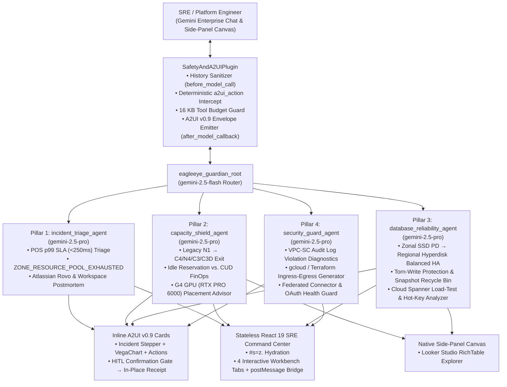

# EagleEye Guardian — Autonomous SRE & Cloud Operations Platform

[](LICENSE)
[](https://google.github.io/adk-docs/)
[](#a2ui-v09-architecture)
[](#stateless-react-19-sre-command-center)

**EagleEye Guardian** is a production-grade, full-stack SRE & Cloud Operations multi-agent system designed for a global high-concurrency retail loyalty, coupon redemption, and Point-of-Sale (POS) transaction platform (`<250ms` p99 SLA across `europe-west2`, `europe-west1`, `us-east1`, `us-east4`, `australia-southeast1`, and `australia-southeast2`) running on **Google Cloud Gemini Enterprise**.

---

## 1. Multi-Agent Architecture



---

## 2. Four SRE Domain Pillars

| Pillar | Sub-Agent | Core Capabilities |
| :--- | :--- | :--- |
| **1. Incident Triage, POS Latency & Postmortem** | `incident_triage_agent` | Monitors `<250ms` p99 retail POS coupon/loyalty APIs across 6 global regions; correlates latency spikes with `ZONE_RESOURCE_POOL_EXHAUSTED` and storage IOPS saturation; integrates with **Atlassian Rovo** (Jira/Confluence) and **Google Workspace** (Docs/Slides/Sheets) for 1-click blameless postmortems. |
| **2. Multi-Region Capacity Shield & GPU Placement** | `capacity_shield_agent` | Tracks legacy 1st-Gen `N1` VM migration to Gen 3/4 (`C4`, `N4`, `C3`, `C3D`) ahead of BFCM peaks; audits **Idle Standby Compute Reservations** vs. CUDs; includes the **G4 GPU Placement Advisor** (NVIDIA RTX PRO 6000) comparing **Spot VMs (`g4-standard-384`)**, **DWS Flex-start** (up to 7 days), and cross-region spillover. |
| **3. Database & Storage Reliability** | `database_reliability_agent` | **Track 1**: Modernizes 50+ TB MySQL clusters from Zonal SSD PD (`100k` IOPS, `1,200 MiB/s`) to **Regional Hyperdisk Balanced HA** (`640k` IOPS, `20,000 MiB/s`, `RPO=0`, `<2.5m` RTO, torn-write protection disabling MySQL doublewrite buffer, 1x/4h dynamic scaling, Snapshot Recycle Bin). **Track 2**: Cloud Spanner transactional ledger load testing (`LongRunningFunctionTool`) with split-boundary & hot-key diagnostics. |
| **4. Security, VPC-SC & Connector Guard** | `security_guard_agent` | Parses `VpcServiceControlAuditMetadata` logs (`SECURITY_POLICY_VIOLATED`, `SERVICE_NOT_ALLOWED_FROM_VPC`, `NO_MATCHING_ACCESS_LEVEL`), emits ready-to-apply `gcloud access-context-manager perimeters` and Terraform HCL patches, and monitors Gemini Enterprise federated connector health. |

---

## 3. A2UI v0.9 Architecture & Guardrails

EagleEye Guardian emits rich interactive surfaces natively rendered by Gemini Enterprise using the `v0.9` composite catalog (`https://www.gstatic.com/vertexaisearch/a2ui/v0_9/gemini_enterprise_composite_catalog.json`):

- **Wire Format**: `Part(inline_data=Blob(mime_type="text/plain", data=b"<a2a_datapart_json>" + json_bytes + b"</a2a_datapart_json>"), part_metadata={"mimeType": "application/json+a2ui"})`
- **Four Core Surfaces**:
  1. **Inline Incident & SLO Triage Card (`MaterialCard`)**: `Stepper` (`Detected → Correlated → Mitigating → Resolved`), `VegaChart` bound at `/chartSpec`, and `MaterialButton` actions.
  2. **Inline HITL Confirmation Gate (`MaterialCard`)**: Pre-filled `MaterialSelect` / `MaterialInput` with client-side validation `checks`, updating **in-place** (`updateComponents` on the same `surfaceId`) into an immutable execution receipt.
  3. **Native Side-Panel Fleet & FinOps Explorer (`Canvas` + `RichTable`)**: Multi-region fleet metrics with clean `tableData.spec = {}` and raw numeric cells.
  4. **Stateless React 19 SRE Command Center (`Canvas` + `IFrameUrl`)**: Hydrated via `#s=z.<deflate-raw-base64url>` with zero backend database dependencies.

---

## 4. Stateless React 19 SRE Command Center (`a2ui-iframe/`)

The `a2ui-iframe/` workbench runs inside the Gemini Enterprise right-hand `Canvas` panel:
- **Zero-Privilege URL Hash Hydration**: Inflates `#s=z.<base64url>` in-browser via `DecompressionStream('deflate-raw')` and falls back to a built-in realistic retail SRE telemetry dataset when opened standalone.
- **Four Interactive Workbench Tabs**:
  1. **BFCM Capacity & N1 Exit Matrix** (including the interactive **G4 GPU Placement Advisor**).
  2. **Hyperdisk Balanced HA & Reservation FinOps Calculator** (live sliders up to `640k` IOPS and `20,000 MiB/s`).
  3. **Cloud Spanner Load-Test & Split Visualizer** (QPS vs. p99 latency, hot-key detection, interleaved schema advice).
  4. **VPC-SC Perimeter & Connector Guard** (1-click Terraform & `gcloud` rule generator + connector OAuth health).
- **Bidirectional `a2ui_action` Bridge**: Dispatches `window.parent.postMessage({ type: "a2ui_action", action, data: { prompt, ...payload } }, targetOrigin)` back to the ADK agent.

---

## 5. Quickstart & Verification

### Run Python Unit Tests, A2UI Validator, and Ruff Linter
```bash
cd eagleeye-sre-agent
CLOUDSDK_CONFIG=/nonexistent uv run pytest tests/unit -v
uv run python scripts/validate_a2ui.py --self-test
uv run ruff check . && uv run ruff format --check .
```

### Build Stateless React 19 `a2ui-iframe` Workbench
```bash
cd a2ui-iframe
npm install
npm run build
```

---

## 6. Copy-Paste Demo Prompt Playbook

### Pillar 1 — Retail POS Latency Triage & 1-Click Blameless Postmortem
```text
Urgent: europe-west2 POS coupon redemption p99 latency jumped to 680ms (SLA <250ms) and we see ZONE_RESOURCE_POOL_EXHAUSTED in europe-west2-b. Correlate Cloud Monitoring metrics with storage IOPS, open the Incident Triage Card, and prepare a blameless postmortem via Atlassian Rovo and Google Workspace.
```

### Pillar 2 — BFCM Legacy N1 Exit, Idle Reservation Audit & G4 GPU Advisor
```text
Audit our BFCM readiness across europe-west2, us-east1, and australia-southeast1: show remaining N1 VMs to migrate to C4/N4, calculate savings from retiring idle standby reservations, and recommend where to place our 64-GPU NVIDIA RTX PRO 6000 (G4) visual-search training workload using Spot vs. DWS Flex-start.
```

### Pillar 3 — MySQL Hyperdisk Balanced HA Modernization & Spanner Load Test
```text
Model migrating our 64 TiB loyalty MySQL cluster from Zonal SSD PD to Regional Hyperdisk Balanced HA (320,000 IOPS, 12,000 MiB/s, torn-write protection enabled), and trigger a 150,000 QPS Cloud Spanner ledger load test to check for hot keys.
```

### Pillar 4 — VPC Service Controls Violation Diagnostics & Connector Guard
```text
Diagnose the recent VPC Service Controls SECURITY_POLICY_VIOLATED and NO_MATCHING_ACCESS_LEVEL blocks on bigquery.googleapis.com and storage.googleapis.com, generate the gcloud and Terraform ingress/egress remediation rules, and check our Gemini Enterprise Atlassian Rovo and Google Workspace connector health.
```

---

## 7. Gemini Enterprise Registration Guide

1. Deploy `a2ui-iframe/` to Cloud Run (`--allow-unauthenticated`, served via `nginx.conf` with no `X-Frame-Options` and `Cache-Control: no-store`).
2. Deploy `eagleeye-sre-agent/` to Vertex AI Agent Engine with environment variables defined in `.env.example`.
3. Register the Agent Engine reasoning engine resource in **Google Cloud Gemini Enterprise** with A2UI v0.9 composite catalog enabled and Federated Connectors linked for Atlassian Rovo and Google Workspace.
